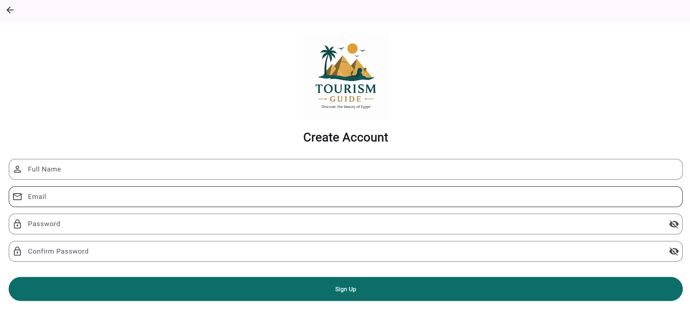
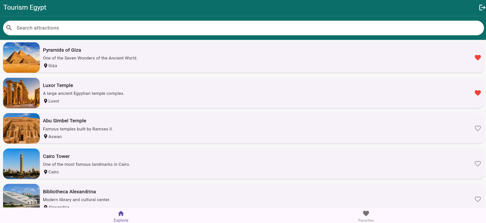
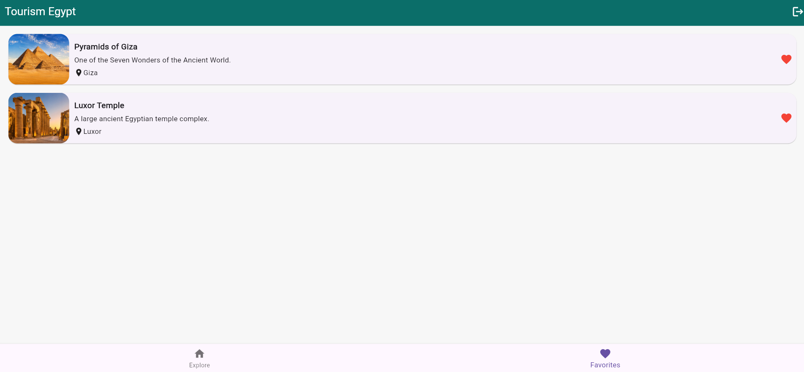

# Tourism Guide

A Flutter app that helps users discover tourist attractions in Egypt.
Users can create an account, log in, browse attractions, and save their favorites to the cloud.


## Screenshots

| Login | Sign Up |
|-------|---------|
|  |  |

| Home | Favorites |
|------|-----------|
|  |  |

## Features

- User registration and login with Firebase Authentication
- Form validation with clear error messages (wrong email or password, weak password, email already in use)
- Password reset by email
- Persistent login: the user stays signed in after closing the app
- Browse attractions with images, descriptions, and locations
- Search attractions
- Add and remove favorites, saved per user in Cloud Firestore
- Logout

## Tech Stack

- Flutter and Dart
- Firebase Authentication
- Cloud Firestore
- Provider (state management)

## Project Structure

```
lib/
  constants/    app colors
  data/         attractions data and favorites manager
  models/       Attraction model
  providers/    AuthProvider
  screens/      splash, login, signup, home, explore, favorites, details
  widgets/      reusable widgets (custom text field, attraction card)
```

## Getting Started

1. Clone the repository:

```bash
git clone https://github.com/Aya-Mohamed-Abo-Alwafa/tourism_guide.git
cd tourism_guide
```

2. Install dependencies:

```bash
flutter pub get
```

3. Set up Firebase (the config files are not included in this repository):

   - Create a project at https://console.firebase.google.com
   - Enable Authentication with the Email/Password provider
   - Create a Cloud Firestore database
   - Install the tools and connect the project:

```bash
npm install -g firebase-tools
firebase login
dart pub global activate flutterfire_cli
flutterfire configure
```

4. Run the app:

```bash
flutter run
```

## Firestore Security Rules

```
rules_version = '2';
service cloud.firestore {
  match /databases/{database}/documents {
    match /users/{userId} {
      allow read, write: if request.auth != null && request.auth.uid == userId;
    }
  }
}
```

## Author

Aya Mohamed Abo Alwafa - https://github.com/Aya-Mohamed-Abo-Alwafa